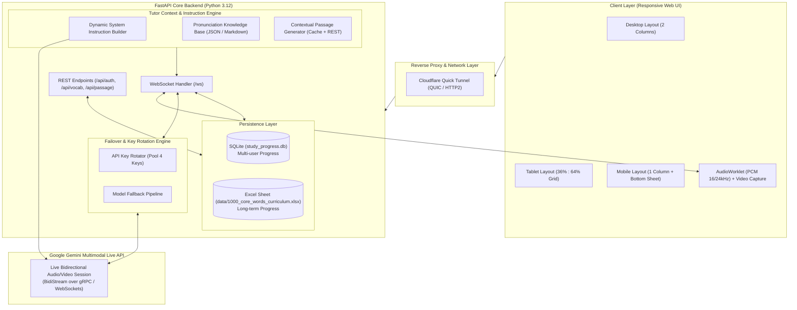
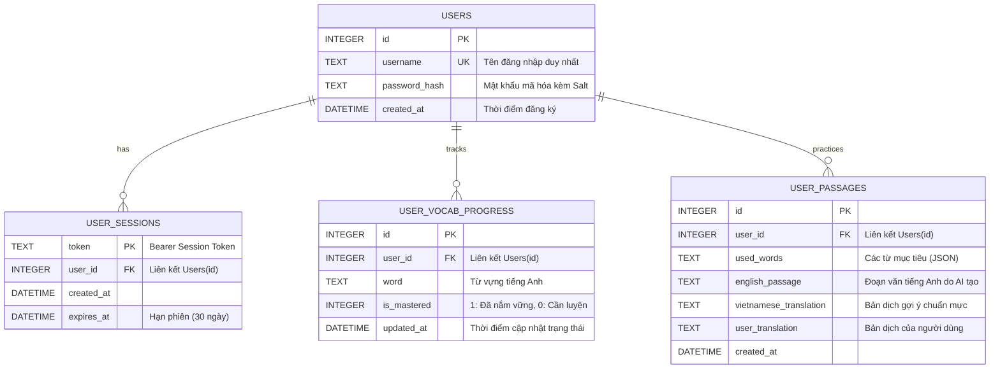

# 🏛️ Hệ Thống Gia Sư Tiếng Anh Tương Tác Trực Tiếp (Gemini Live English Tutor) - Kiến Trúc Kỹ Thuật (Architecture Specification)

Tài liệu này đặc tả chi tiết kiến trúc hệ thống, nguyên lý truyền phát âm thanh thời gian thực (Real-time Audio Streaming), thuật toán dự phòng thông minh (Failover & Key Rotation), mô hình cơ sở dữ liệu đa người dùng và luồng ngữ cảnh học tập của dự án **Gemini Live English Tutor**.

---

## 1. Sơ Đồ Kiến Trúc Tổng Thể (High-Level Architecture)

Hệ thống hoạt động theo mô hình Full-Stack tương tác thời gian thực hai chiều, kết hợp giữa giao tiếp WebSocket độ trễ siêu thấp và RESTful API đồng bộ dữ liệu:



---

## 2. Luồng WebSocket Hai Chiều (Bidirectional Real-Time Audio Streaming)

### 2.1 Định dạng âm thanh & Thông số kỹ thuật
* **Chiều vào (Client $\to$ Backend $\to$ Gemini)**:
  * Trình duyệt thu âm qua Web Audio API (`AudioContext`, `AudioWorkletNode`).
  * Chuẩn hóa về **PCM 16-bit Mono, tần số lấy mẫu 16,000 Hz hoặc 24,000 Hz**.
  * Dữ liệu âm thanh được gửi thành các mẩu nhị phân (chunks) đóng gói dạng Base64 qua WebSocket.
* **Chiều ra (Gemini $\to$ Backend $\to$ Client)**:
  * Gemini Live API phản hồi luồng âm thanh dạng **PCM 24,000 Hz (24kHz Mono, 16-bit Little Endian)**.
  * Backend chuyển tiếp trực tiếp xuống frontend qua WebSocket.
  * Frontend sử dụng hàng đợi `AudioQueue` phát mượt mà, hỗ trợ cơ chế ngắt lời tự nhiên (Barge-in / Interruption handling): Khi người dùng nói, model tự động dừng phát câu hiện tại.

### 2.2 Sơ đồ tuần tự giao tiếp (Sequence Flow)

```
User (Browser)               FastAPI Backend (/ws)              Gemini Live API
      |                               |                                |
      |--- 1. Connect WebSocket ----->|                                |
      |    (Bearer Token in Query)    |--- 2. Resolve User & Vocab --->| (Fetch Mastered Words)
      |                               |--- 3. Inject Context & Rules ->| (Setup Connection)
      |                               |<-- 4. Session Established -----|
      |<-- 5. Connection Ready -------|                                |
      |                               |                                |
      |=== 6. Stream Audio PCM =======>|=== Stream Audio PCM ==========>|
      |    (User speaks English)      |                                |
      |                               |<== 7. Stream Audio 24kHz =====| (Live Tutor Feedback)
      |<== 8. Stream Audio Output ====|<== Real-time Transcription ===|
      |    (Hear Teacher's Voice)     |                                |
      |                               |                                |
      |--- 9. User Interrupts ------->|--- Forward Interruption ------>|
      |    (Speech detected)          |<-- Truncate audio buffer ------|
```

---

## 3. Thuật toán Xoay Vòng 4 API Key & Model Fallback (Failover Engine)

### 3.1 Cơ chế xoay vòng 4 API Key (Round-Robin with Error Sensing)
Hệ thống duy trì một danh sách gồm 4 API Key độc lập được cấu hình trong biến môi trường `GEMINI_API_KEYS`.

```python
GEMINI_API_KEYS = [
    "AIzaSyExampleKeyPrimary_111111111111",   # Key 1 (Primary)
    "AIzaSyExampleKeyBackup_222222222222",    # Key 2 (Backup 1)
    "AIzaSyExampleKeyBackup_333333333333",    # Key 3 (Backup 2)
    "AIzaSyExampleKeyBackup_444444444444",    # Key 4 (Backup 3)
]
```

**Nguyên lý hoạt động:**
1. Bộ điều phối (`KeyManager`) giữ chỉ số con trỏ `current_key_index` (mặc định trỏ về 0).
2. Khi thực hiện kết nối WebSocket Live hoặc gửi request sinh bài đọc qua REST:
   * Nếu gặp các ngoại lệ liên quan đến cạn kiệt tài nguyên:
     * Mã trạng thái HTTP `429` (Too Many Requests).
     * Chuỗi lỗi chứa `RESOURCE_EXHAUSTED`, `quota`, `rateLimitExceeded`.
   * Hệ thống lập tức thực hiện:
     $$\text{current\_key\_index} = (\text{current\_key\_index} + 1) \pmod{\text{len(GEMINI\_API\_KEYS)}}$$
   * Ghi log cảnh báo mức `WARNING` ra hệ thống kèm chỉ số Key mới.
   * Lập tức tái khởi tạo phiên kết nối hoặc retry yêu cầu mà người dùng **không hề bị ngắt quãng phiên học**.

### 3.2 Chuỗi Model Live Fallback
Khi một phiên Live Connect được kích hoạt, danh sách model được thử nghiệm tuần tự theo mức độ ưu tiên:
1. `gemini-3.8-live` (Model Live mới nhất, tối ưu phản xạ âm thanh)
2. `gemini-3-flash-live` (Tốc độ phản hồi cực nhanh)
3. `gemini-2.5-flash-native-audio` (Bản âm thanh gốc 2.5)
4. `gemini-2.0-flash-exp` (Bản Live thực nghiệm ổn định)

---

## 4. Mô Hình Dữ Liệu Phân Chia Tiến Độ Đa Người Dùng (SQLite Isolation)

Để đảm bảo tính độc lập và bảo mật, hệ thống sử dụng **SQLite** (`study_progress.db`) kết hợp băm mật khẩu chuẩn Salted SHA-256 / PBKDF2:



### Nguyên lý cách ly dữ liệu (Data Isolation):
* Khi **User A** tích chọn các từ đã thuộc, các bản ghi trong `user_vocab_progress` chỉ gắn với `user_id = A`.
* Khi **User B** đăng nhập trên thiết bị khác hoặc cùng thiết bị, hệ thống chỉ truy vấn trạng thái theo `user_id = B`. Tiến độ của User A hoàn toàn không bị ảnh hưởng.
* Khi khách vãng lai (Guest) sử dụng mà chưa đăng nhập, hệ thống lưu tạm thời vào `localStorage` trình duyệt và tự động đồng bộ lên tài khoản ngay sau khi người dùng Đăng ký / Đăng nhập.

---

## 5. Thuật Toán Lọc Ngữ Cảnh & Dynamic System Instruction

Một trong những tính năng thông minh cốt lõi của hệ thống là **sự đồng bộ ngữ cảnh giữa Tab Luyện Dịch và Tab Đàm Thoại Trực Tiếp**:

```
                       [Tab 2: Luyện Dịch]
                     Người dùng tích chọn từ
                                |
               +----------------+----------------+
               |                                 |
         [Đã tích chọn]                  [Chưa tích chọn]
      (Từ đã thuộc/Đã học)            (Từ còn yếu/Cần luyện)
               |                                 |
               v                                 v
        Loại trừ khỏi                    Nạp làm trọng tâm
       phiên khảo sát                     kiểm tra phản xạ
               |                                 |
               +----------------+----------------+
                                |
                                v
               [Dynamic System Instruction]
        - AI Tutor chào hỏi và khen ngợi số từ đã đạt.
        - AI Tutor chỉ tập trung đặt câu hỏi, kiểm tra
          phát âm xoay quanh danh sách TỪ CHƯA THUỘC.
```

### Mẫu cấu trúc System Instruction được tạo động:
```
You are an expert native English pronunciation and conversation tutor named 'Gemini Tutor'.
The student has mastered the following words: {mastered_words_list} (Count: {mastered_count}).
DO NOT ask or test the student on words they already mastered.

Instead, FOCUS intensively on practicing these remaining priority words:
{remaining_priority_words}

Pedagogical Rules:
1. Warm, encouraging, concise spoken English (1-2 sentences per response).
2. Correct pronunciation errors immediately with friendly phonetic guidance.
3. Invite the student to practice speaking sentences containing the target priority words.
```

---

## 6. Kiến Trúc Giao Diện Responsive Đa Thiết Bị

Hệ thống được thiết kế theo tư duy Mobile-First & Adaptive Tablet/Desktop Layout:

```
+-----------------------------------------------------------------------------+
| Desktop (> 1180px): 2 Cột cố định (460px Sidebar : 1fr Khu vực luyện dịch) |
+-----------------------------------------------------------------------------+
| Tablet (768px - 1180px): 2 Cột linh hoạt (36% Sidebar : 64% Khu vực dịch)   |
| Touch targets >= 44px, cuộn độc lập, co giãn mượt cả Portrait & Landscape    |
+-----------------------------------------------------------------------------+
| Mobile (< 768px): 1 Cột toàn màn hình                                       |
| Cột từ vựng giấu kín -> Bật lên dạng Bottom Sheet (Modal trượt từ đáy 85vh) |
+-----------------------------------------------------------------------------+
```

* **Desktop**: Bố cục 2 cột cố định bên trái, bên phải bài đọc đối chiếu song song.
* **Tablet (iPad)**: Cột từ vựng co giãn ở tỷ lệ vàng **36% : 64%**, giữ nguyên thanh công cụ trên đầu, hỗ trợ xoay ngang/dọc tự nhiên.
* **Mobile**: Thanh công cụ và danh sách chủ đề được ẩn triệt để khỏi luồng cuộn chính; thay bằng nút bấm nổi bật duy nhất `📚 Chọn từ vựng luyện tập (Đang chọn: X từ) ▼` kích hoạt Bottom Sheet hiện đại với backdrop làm mờ trang web.
